# UniBond

Connect undergraduates and alumni at the University of Vavuniya to jobs, projects, and skills.

> **Platforms:** React Native (Expo) mobile app
> **Backend:** Supabase (Postgres + Auth + Storage + Realtime)
> **Chat:** Stream Chat
> **Styling:** Tailwind CSS (NativeWind for RN)

---

## Table of Contents

* [About](#about)
* [Core Features](#core-features)
* [Architecture](#architecture)
* [Tech Stack](#tech-stack)
* [Screens & Flows](#screens--flows)
* [Data Model](#data-model)
* [Getting Started](#getting-started)

  * [Prerequisites](#prerequisites)
  * [Environment Variables](#environment-variables)
  * [Run the Mobile App](#run-the-mobile-app)
  * [Run the Admin Web (Optional)](#run-the-admin-web-optional)
* [Folder Structure](#folder-structure)
* [API & Services](#api--services)
* [Quality, Security & Branching](#quality-security--branching)
* [Roadmap](#roadmap)
* [Contributing](#contributing)
* [License](#license)

---

## About

**UniBond** is a community platform for University of Vavuniya alumni and undergraduates. It enables users to:

* Post and discover **jobs/internships**
* Showcase **projects** and **skills**
* **Message** peers and mentors securely
* Build a **verifiable profile** connected to university records (admin-reviewed)

The university admin manages verification, moderation, and high‑level analytics via a small web dashboard.

## Core Features

* **Profiles:** Undergraduate & Alumni profiles with education, skills, links, and badges
* **Opportunities:** Job and internship postings with apply/save workflows
* **Projects:** Portfolio projects with tags, media, and collaborators
* **Skills:** Skill tags with proficiency levels and search
* **Chat:** 1–1 and group chats powered by Stream Chat
* **Notifications:** Realtime updates (applications, messages, approvals)

## Architecture

```
Mobile (Expo/React Native)
  ↕  Supabase (Postgres, Auth, Storage, Realtime, Row Level Security)
  ↕  Stream Chat (messaging)
Admin Web (Next.js or similar – optional)
```

* **Auth:** Supabase email/password + OAuth (optional). RLS policies enforce per‑role access.
* **Storage:** Supabase Storage for avatars/resumes/project media.
* **Realtime:** Live updates for applications, messages, and admin approvals.

## Tech Stack

* **Mobile:** React Native (Expo), NativeWind/Tailwind
* **Backend:** Supabase (Postgres, Auth, Storage, RLS)
* **Chat:** Stream Chat SDK for React Native
* **Web Admin (optional):** Next.js + Tailwind + Supabase JS client
* **Tooling:** TypeScript, ESLint/Prettier, Jest/React Testing Library

## Screens & Flows

* **Auth:** Sign up · Login · Forgot Password · Onboarding
* **Home Feed:** Recent jobs, projects, and highlights
* **Search:** Users · Jobs · Projects · Skills
* **Profile:** View/Edit profile, add skills & links, upload media
* **Jobs:** List · Detail · Apply · Save · Manage (for posters)
* **Projects:** List · Detail · Add/Edit · Tagging · Collaborators
* **Chat:** 1–1 and group conversations, unread indicators


## Data Model

> **Note:** Minimal draft—adapt in Supabase SQL.

**users**

* id (uuid, pk)
* role (enum: `undergrad`, `alumni`, `admin`)
* full\_name, email, avatar\_url
* faculty, department, batch\_year
* bio, links (jsonb)
* created\_at

**skills**

* id (uuid, pk)
* name (text, unique)

**user\_skills**

* user\_id → users.id
* skill\_id → skills.id
* level (int 1–5)

**projects**

* id (uuid, pk)
* owner\_id → users.id
* title, description, tags (text\[])
* media\_urls (text\[])
* created\_at

**jobs**

* id (uuid, pk)
* poster\_id → users.id
* title, company, location, type (enum), tags (text\[])
* description, apply\_link
* created\_at, expires\_at

**applications**

* id (uuid, pk)
* job\_id → jobs.id
* applicant\_id → users.id
* cv\_url, message
* status (enum: `submitted`, `reviewing`, `accepted`, `rejected`)
* created\_at

> Add RLS policies to enforce: users can read public content; edit only their own; admins have broader rights.

## Getting Started

### Prerequisites

* Node.js LTS, pnpm or yarn
* Expo CLI (`npm i -g expo`)
* Supabase project + Database URL & anon key
* Stream Chat account & API key (optional at first)

### Environment Variables

Create a `.env` (or `.env.local`) at the project root.

```
EXPO_PUBLIC_SUPABASE_URL=...
EXPO_PUBLIC_SUPABASE_ANON_KEY=...
EXPO_PUBLIC_STREAM_CHAT_KEY=...
# Optional
EXPO_PUBLIC_SENTRY_DSN=
```

### Run the Mobile App

```bash
# install deps
 npm install  # or yarn / npm

# start expo
 npm expo start
# press i for iOS simulator, a for Android, or scan QR with Expo Go
```


Configure the same Supabase env vars (without the `EXPO_PUBLIC_` prefix if not needed).

## Folder Structure

```
uni-bond/
  apps/
    mobile/            # Expo app
    admin/             # Next.js admin (optional)
  packages/
    ui/                # Shared UI components
    lib/               # Supabase client, hooks, utils
  supabase/
    migrations/        # SQL migrations & RLS policies
  README.md
```

## API & Services

* **Supabase JS Client:** handles auth, queries, storage uploads.
* **Service Hooks:** `useAuth()`, `useJobs()`, `useProjects()`, `useChat()`
* **Chat:** Initialize Stream Chat client on login; disconnect on logout.

Example (RN):

```ts
import { createClient } from '@supabase/supabase-js'

export const supabase = createClient(
  process.env.EXPO_PUBLIC_SUPABASE_URL!,
  process.env.EXPO_PUBLIC_SUPABASE_ANON_KEY!
)
```

## Quality, Security & Branching

* **Code Quality:** ESLint + Prettier + TypeScript strict
* **Testing:** Jest + React Testing Library (mobile), Playwright (web)
* **Security:** Supabase RLS policies; audit logs for admin actions
* **Branching (team workflow):**

  * Keep `main` protected; merge via PR after review
  * Each member works on a **test/feature** branch
  * **Daily**: update your branch from `main`
  * One maintainer merges reviewed branches into `main`

## Roadmap

* [ ] Email/OAuth login
* [ ] Profile verification workflow (admin)
* [ ] Job posting & application tracking
* [ ] Project portfolios with media uploads
* [ ] Search & filters across users/jobs/projects/skills
* [ ] In‑app chat (Stream Chat)
* [ ] Push notifications
* [ ] Analytics & exports (admin)

## Contributing

1. Fork the repo and create a feature branch from `main`
2. Commit with conventional messages (e.g., `feat: add job filters`)
3. Open a PR; request review; ensure checks pass

## License

UOV © 2025 UniBond Team

---

### Badges

[](https://expo.dev/)
[](https://supabase.com/)
[](https://getstream.io/chat/)
[](LICENSE)


## Screenshots

### Authentication & Start
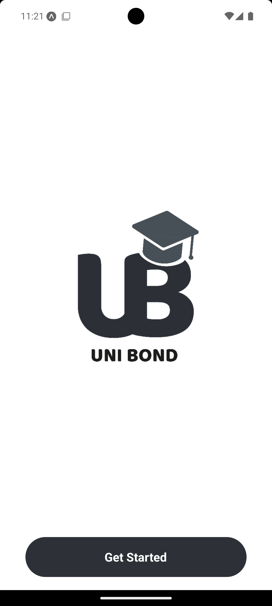
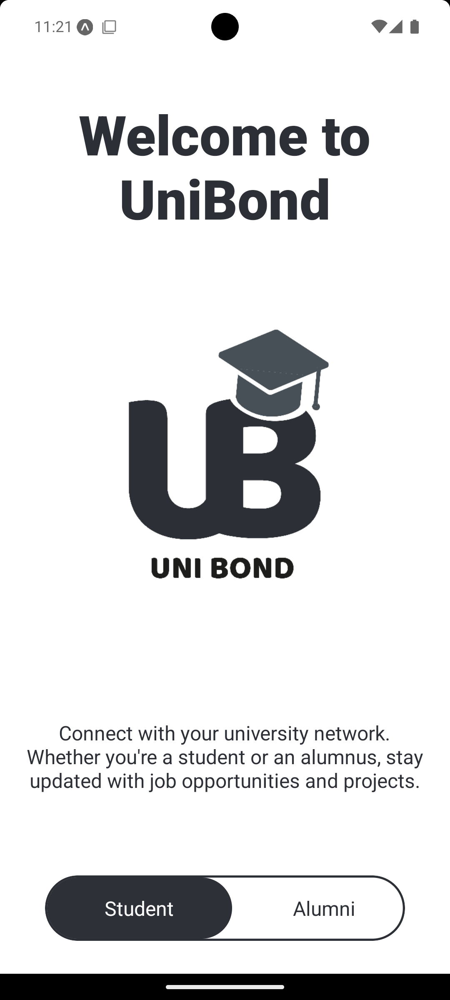
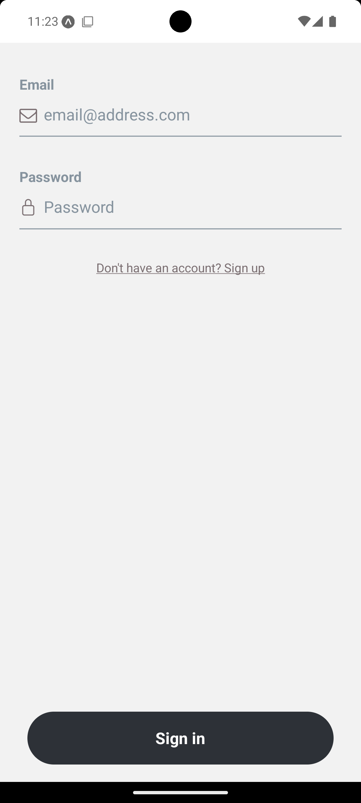
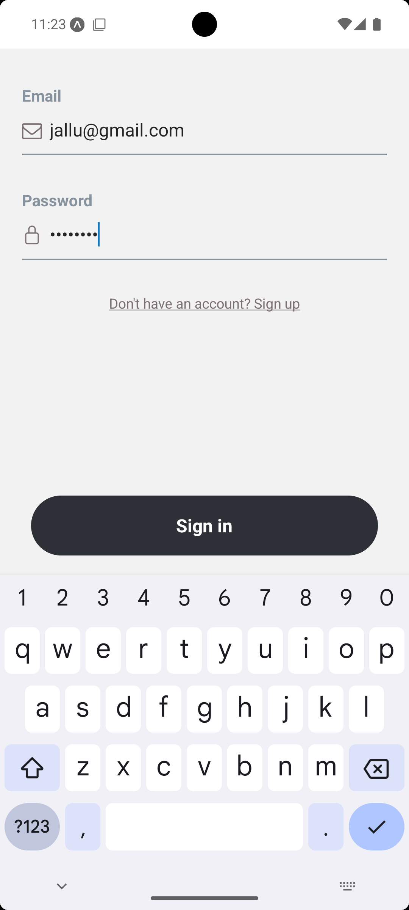
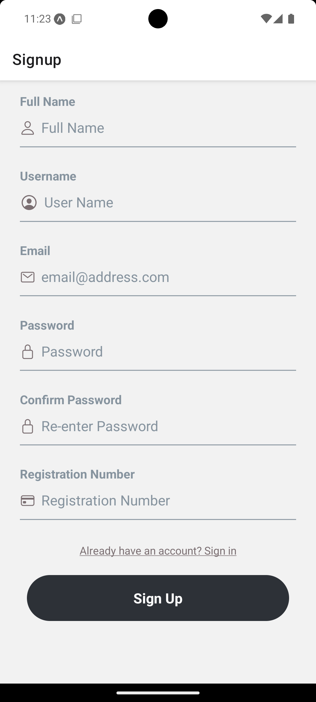
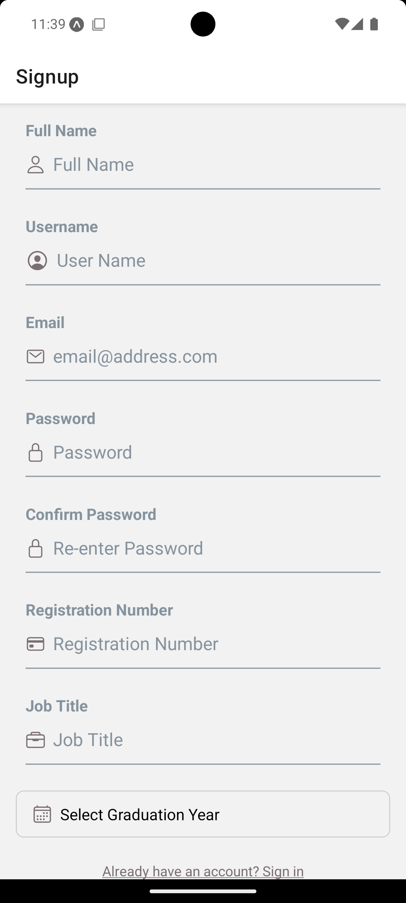

### Home & Search
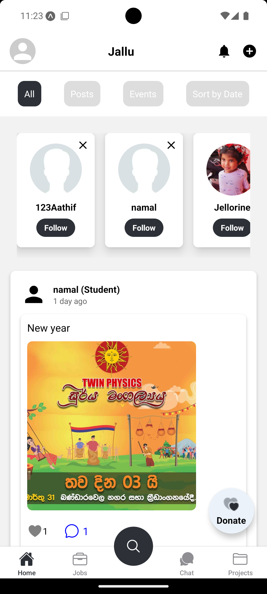
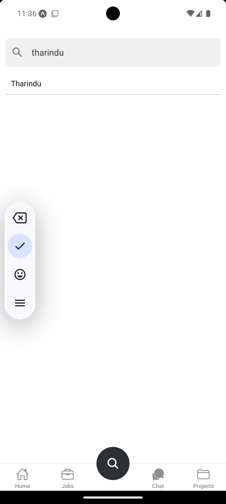
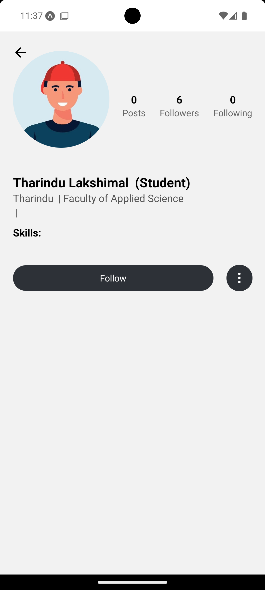

### Jobs & Projects
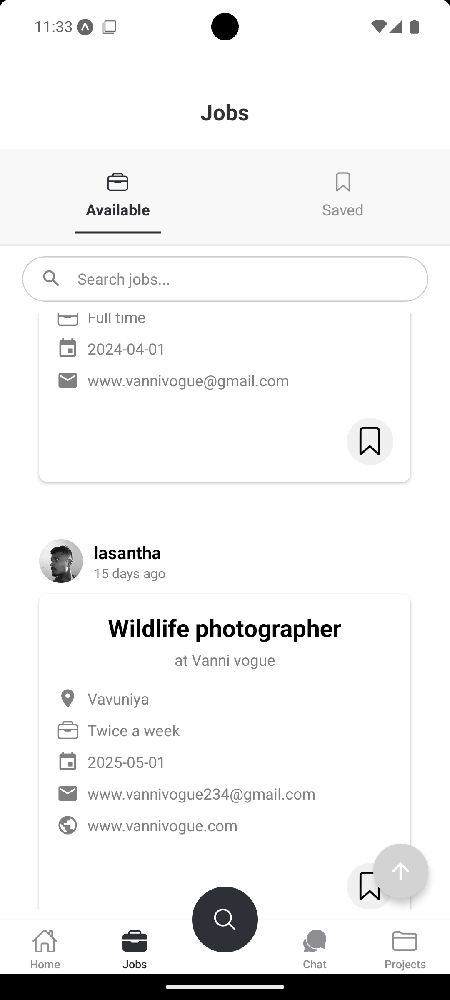
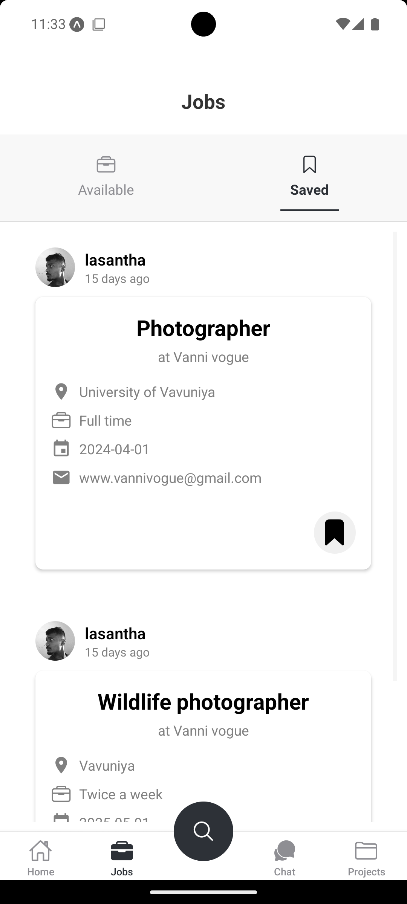
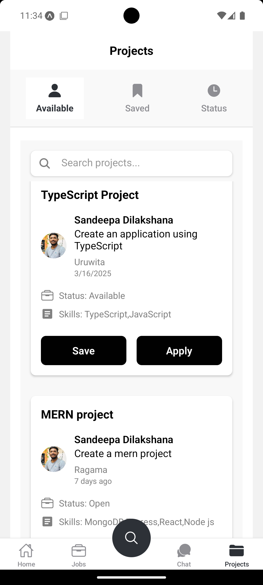
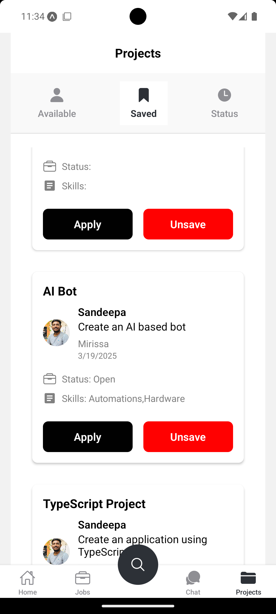
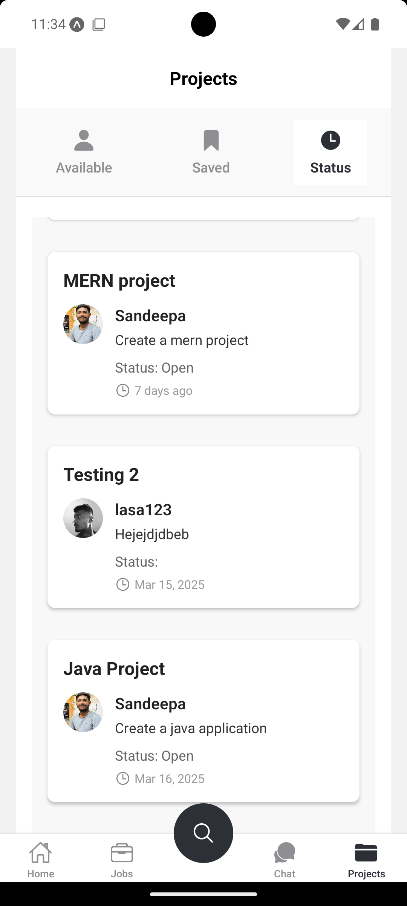

### Profiles
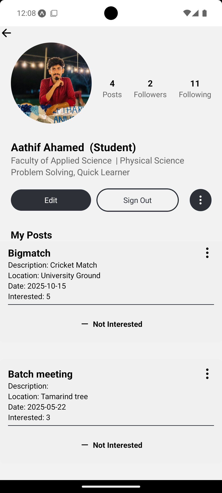
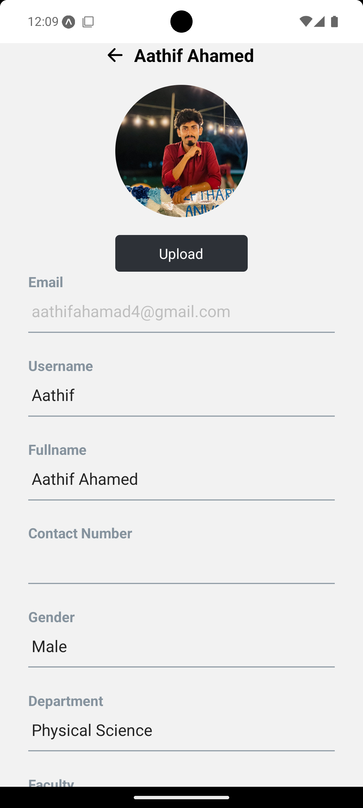
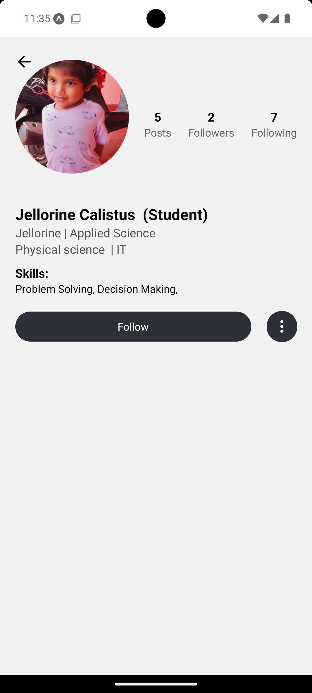
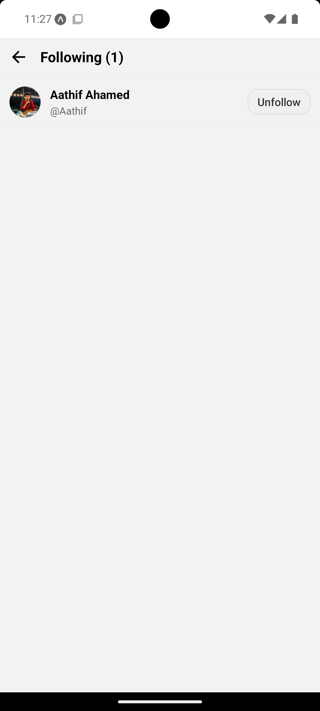

### Communication & Notifications
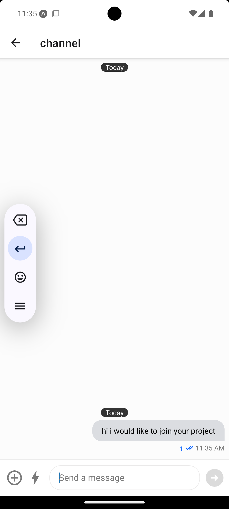
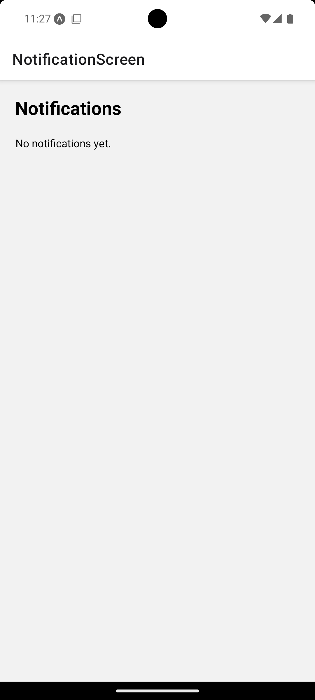


